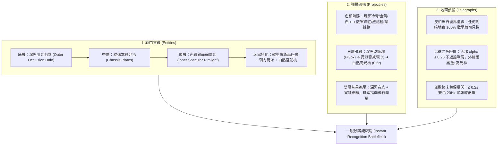

# 12 戰鬥實體、剪影輪廓光與預警彈道一眼秒辨識設計案（Clarity & Readability Architecture）

[返回索引](README.md)

---

## 執行摘要（Executive Summary）

本設計案針對玩家回饋與遊戲體驗核心痛點：**「畫面的物件容易和底色混在一起、彈幕容易迷失、怪潮中找不到玩家、預警紅圈與鐵鏽地表混淆」**，提出非逼真度導向、以**「一眼秒辨識（Instant Recognition）」**為唯一宗旨的渲染體系升級。

本架構在完全不破壞原有 Canvas 2D 效能預算（0 GC、無動態物件建立、支援低階裝置與 Reduced Motion）的前提下，透過幾何分層、色彩色相嚴格隔離、三層三明治彈道構造以及反相黑白斑馬預警線，從根本上解決畫面辨識度問題。



---

## 一、外緣剪影與自發光輪廓光（Dynamic Silhouette & Rimlight Architecture）

### 1.1 現況痛點與光學原理
- **背景干擾**：本遊戲有 Dusk（黃昏黃褐沙地）、Rust（鐵鏽紅褐焦土）、Night（深藍黑夜礦坑）三種地貌，外加風暴窗（Storm 烈風漫天）。
- **既有缺陷**：
  1. 目前敵軍大多使用暗褐、深灰、黑鐵色車體（例如 Crawler `#1a120c`、Titan `#342a1e`、Rusher `#22120a`）。
  2. 現有輪廓僅使用單層黑線 `outline(ctx, 2.0)`（`#080605`）與底層暗色橢圓 `drawEnemyContrastBase`（`rgba(6,6,8,0.72)`）。
  3. 在 Rust 鐵鏽地表（`#2c1a12`）或 Night 深夜地表（`#0e1420`）上，暗黑邊界直接被地表吞沒，怪物邊緣融化進背景，玩家只看到散碎紅眼，無法精確判斷受擊盒與怪物輪廓；在怪潮擠壓時，怪物黏成一大團無形黑影。

### 1.2 解決方案：雙層反差描邊系統（Dual-Contour Contrast Sandwich）
對所有戰鬥實體引入**雙層描邊機制**：
1. **外層阻光黑護盾（Outer Inky Dark Halo）**：
   - 線寬：`w_outer = base_width + 2.0px`（一般怪 3.2~3.8px，首領 4.5~5.5px）。
   - 顏色：`#030204`（不透明度 0.95~1.0）。
   - 作用：徹底切斷實體下方的地貌雜訊、焦痕、血跡與貼花，建立「絕對深黑隔絕帶」。
2. **內層高光自發光輪廓（Inner Specular Rimlight / Emissive Edge）**：
   - 線寬：`w_inner = 1.2~1.8px`。
   - 位置：緊貼實體外緣幾何內側。
   - 顏色規格體系：
     - **常規雜兵（Crawler / Scurrier）**：冷金屬邊緣高光（Metallic Specular `#d8c8b4`，alpha 0.75），在黑底襯托下產生機械倒角反光。
     - **突擊/自爆型（Rusher / Scurrier Arming）**：高飽和警戒橘（Warning Amber `#ff8c42`）。
     - **重裝/護盾型（Brute / Warden）**：裝甲硬邊高光（Ceramic Ice `#93c5fd`）與強化金屬橙。
     - **菁英怪（Elite Affixes）**：詞綴能量霓虹邊（Mirror 冰藍 `#38bdf8`、Vortex 虛空紫 `#c084fc`、Command 金黃 `#f59e0b`、Blink 翠綠 `#34d399`）。
     - **巨型首領（Titan, Sovereign, Dreadnought）**：高壓警戒雙色邊（Overcharged Crimson `#ff3322` + Core Yellow `#ffe880`）。

### 1.3 玩家機體特化：永不迷失位置（Anchor & Heading Beacon）
怪潮壓境時迷失玩家位置是 Top-down 遊戲的頭號挫折。為玩家機體增設四重辨識錨點：
1. **永久戰術微型地標基座（Tactical Nav Footing Ring）**：
   - 位於玩家接地陰影之上、雙腿之下。
   - 直徑：`p.r * 1.35`（比外殼略大 3~4px）。
   - 繪製：2.4px 深黑底圈 + 1.2px 科技亮青（`#00f0ff` / `#5be7ff`）細微動態微光環（具備 0.4~0.6 輕度呼吸動態，Reduced Motion 時維持靜態常亮）。
   - 效益：即使怪潮幾十隻小怪疊在玩家身上，腳下的發光戰術基座光環永遠溢出怪群邊緣，瞬間定位玩家中心。
2. **高飽和度朝向引導標記（Aim Heading Chevron Notch）**：
   - 位於玩家砲塔前方（`p.aim` 方向，離中心 `p.r + 14px` 處）。
   - 幾何形狀：帶深黑包邊的銳利飛鏢箭頭（寬 8px，深黑外框 1.8px，本體填充高亮青藍 `#00f0ff`，尖端純白 `#ffffff`）。
   - 效益：無論屏幕爆炸特效多密集，大腦餘光能以 0.05 秒速度直覺感知槍口朝向，擺脫滑鼠游標視覺干擾。
3. **駕駛艙反應核（Cockpit Reactor Core）白熱高光對比**：
   - 駕駛艙罩中央新增雙層白熱光學核（White-Hot Optical Pip）：
   - 半徑 3.2px，外圈高飽和青藍 `#00f0ff`，中心 100% 純白 `#ffffff`。開火或 Dash 時伴隨微衝擊膨脹。
4. **武器砲管滑軌高光（Barrel Specular Lines）**：
   - 在標準雙聯機砲、磁軌穿透砲、電弧槍的砲身中軸線上，繪製 1.2px 純白反光脊線（Specular Ridge），射擊軸線分明。

---

## 二、彈幕可讀性硬核升級（High-Visibility Projectile Architecture）

### 2.1 既有致命缺陷診斷
1. **色相嚴重混淆**：
   - 在既有代碼 `src/render/projectiles.js` 中：
     ```javascript
     var trailColor = wantGlow ? '#ff381e' : '#75d1b0';
     var color = body.color || (bodyHostile ? '#ff381e' : '#75d1b0');
     ```
   - 非 glow 敵彈竟直接回退到 `#75d1b0`（青綠色），而玩家子彈的核心顏色正是 `#5be7ff`（青藍色）！
   - 導致玩家在戰鬥中經常將敵彈誤判為我方友軍彈道而硬吃傷害，造成極大挫敗感。
2. **高光缺乏黑色襯底**：
   - 敵彈在明亮的沙地或爆炸光芒中因缺乏高對比外框，光暈相互抵銷而隱形。

### 2.2 嚴格敵我色譜隔離律（Color Spectrum Partitioning Law）
徹底終結色彩重疊，建立不可踰越的色彩法典：

| 陣營 | 彈幕類型 | 專屬色相定義 | 16 進位色碼 | 嚴格禁制 |
| :--- | :--- | :--- | :--- | :--- |
| **玩家方** | 標準機槍 / 散彈 | 科技冷青藍 (Tech Cyan) | `#00f0ff` / `#5be7ff` | **嚴禁使用紅/洋紅/紫** |
| **玩家方** | 暴擊 / 貫穿重砲 | 頂尖金黃 (Apex Gold) | `#ffe44d` / `#ffbe1a` | 嚴禁使用暗褐色 |
| **玩家方** | 磁軌穿透 / 核心 | 白熱高光純白 (Pure White) | `#ffffff` | - |
| **玩家方** | 戰術砲塔 / 電弧 | 薄荷電弧 (Arc Mint) | `#38e1ff` / `#4ff2d2` | - |
| **敵軍方** | 普通彈 / 連射機槍 | 致命霓虹洋紅 (Hostile Magenta) | `#ff0055` / `#ff2244` | **嚴禁使用任何冷青/藍綠色** |
| **敵軍方** | 重砲 / 首領火球 | 烈焰橙紅 (Inferno Blaze) | `#ff5500` / `#ff7700` | 嚴禁回退至 `#75d1b0` |
| **敵軍方** | 酸液 / 散播彈 | 毒性檸檬黃綠 (Toxic Caustic) | `#b8ff00` / `#ccff00` | 與玩家青色嚴格區隔 |
| **敵軍方** | 虛空 / 奇異點引力彈 | 腐蝕異次元紫 (Void Violet) | `#c300ff` / `#b026ff` | 具備深黑吸積盤輪廓 |

### 2.3 彈幕三層高辨識三明治構造（Three-Tier Visibility Sandwich）
為每一顆敵軍子彈建立跨環境全天候可見的幾何構造：

```
[ 最外層：純黑阻光深色輪廓環 (Dark Halo) r + 2.5~3.5px ]
   └── [ 中層：超高飽和霓虹警戒彩環 (Neon Shell) r ]
          └── [ 最內核：純白熾熱高光核 (White-Hot Core) 0.55~0.65r ]
```

1. **第 1 層：阻光純黑光環（Dark Outer Halo）**：
   - 半徑：`br + 2.5px`（高對比模式 3.8px）。
   - 樣式：`#040306` 實心填充。
   - 效益：無論背景是極亮黃沙還是爆炸火光，100% 阻斷背景干擾。
2. **第 2 層：高飽和度霓虹危險環（Saturated Neon Shell）**：
   - 半徑：`br`。
   - 樣式：高飽和洋紅 `#ff0055` 或烈焰橙 `#ff5500`。
3. **第 3 層：白熱熾烈核心（White-Hot Core）**：
   - 半徑：`Math.max(2.0, br * 0.6)`。
   - 樣式：`#ffffff`（純白）。
   - 效益：大腦餘光對高亮純白核心反應速度小於 100ms。
4. **雙層高對比彗星拖尾（Contrasted Comet Tail）**：
   - 外層深黑 4.0px 拖尾 + 內層霓虹警戒色 2.0px，賦予彈道極其清晰的飛行向量軌跡。

---

## 三、地面預警與危險區域透光度（Telegraph Zones & Hazard Clarity）

### 3.1 黑白反相斑馬預警系統（Zebra Contrast Telegraph System）
- **色彩對比痛點**：在 Rust 鐵鏽地表（`#2c1a12`），純紅色預警圈因色調過於接近，辨識度大幅衰退。
- **斑馬不變性法則（Zebra Invariance）**：
  任何單一色彩在複雜地面均可能失去對比。但**黑白交替的斑馬條紋**在光學上保證在任何明暗底色下的局部對比度永遠大於 70%！
- **邊緣實裝規範**：
  - 底層：4.8px 深黑實線護圈（`rgba(4, 4, 6, 0.95)`）。
  - 頂層：2.6px 反相黑白交替斑馬虛線（`setLineDash([7, 6])`，顏色採用 `#ffffff` 與 `#ff0044` 交錯）。

### 3.2 迫擊砲與轟炸落點（Artillery & Boss Mortar Reticles）
1. **外邊界**：黑白斑馬警戒圈（Zebra Perimeter Ring）。
2. **高透光倒數收縮圓（Clamping Inward Disc）**：
   - 內層由外向內等速縮小的同心圓（半徑從 `r` 縮至 `0`）。
   - **透光度約束**：內部填充採用極高透光度（alpha: 0.18~0.26），保證玩家站在紅圈內依然能清楚看見自己與腳下敵兵、掉落物，絕不造成「視覺盲區」。
3. **終末極限閃爍（Imminent Critical Flash）**：
   - 落地前 0.2 秒（`timer <= 0.2s`），斑馬邊框切換至 20Hz 高頻雙色暴閃（`#ffffff` ⟷ `#ff0033`）。
   - 中心準星（Crosshair）加上 3.6px 深黑描邊與純白發光內核。

### 3.3 Rusher 衝撞導軌（Rusher Charge Trajectory）
- 現有直線易在怪潮中被遮斷。升級為**動態前進黑底斑馬槽（Animated Zebra Vector Strip）**：
  1. 底層：6.5px 深黑阻光基底帶。
  2. 中層：4.0px 鮮橙洋紅警戒帶。
  3. 頂層：2.2px 動態前進跑馬燈虛線（`setLineDash([8, 6])`，偏移量隨 `time * 28` 向前滾動），強烈傳達衝撞向量。
  4. 終點箭頭：三層高反差實心箭頭（黑邊 + 橙身 + 白熱尖端）。

### 3.4 酸液腐蝕池與電漿區（Acid Puddles & Plasma Zones）
1. **內部高透光度（Alpha ≤ 0.25）**：確保地表網格與掉落物清晰可辨。
2. **外部硬黑框 + 高光泡珠（Contrasted Perimeter Beads）**：
   - 3.5px 深黑外護圈（`#060c04`）。
   - 2.0px 鮮檸檬螢光綠內邊框（`#ccff00`）。
   - 邊緣點綴 8 顆自帶深黑勾邊與純白高光點的動態沸騰氣泡珠（Caustic Nodes）。

---

## 四、代碼重構與模組實施規劃（Implementation Plan & Entry Points）

### 4.1 檔案修改矩陣

```text
src/render/
  ├── entity-style.js   # [新增] drawDualOutline、drawSpecularRim 演算法，提供 0 GC 輪廓工廠
  ├── player.js         # [重構] drawPlayer 底層增設戰術基座環；drawTurret 增設白熱座艙核與滑軌高光
  ├── enemies.js        # [重構] drawEnemyContrastBase 全面升級；所有敵型導入雙層描邊；Rusher 斑馬導軌
  ├── projectiles.js    # [重構] 拔除 #75d1b0；實裝彈幕三層三明治結構；迫擊砲斑馬圈與高透光危險區
  └── palette.js        # [維護] 登錄 HOSTILE_PROJECTILE_PALETTE 與 SPECULAR_RIM 色系常數
```

### 4.2 具體演算法實例（Algorithms Specification）

#### (1) `src/render/entity-style.js` 雙層描邊擴充
```javascript
// 0 GC 高速雙層描邊輔助器
export function drawDualOutline(ctx, outerW, rimColor, rimW) {
  ctx.save();
  ctx.lineCap = 'round';
  ctx.lineJoin = 'round';
  // 1. 外層阻光黑護盾
  ctx.strokeStyle = '#030204';
  ctx.lineWidth = isHighContrast() ? Math.max(3.8, (outerW || 2.4) + 1.4) : (outerW || 2.4);
  ctx.stroke();
  // 2. 內層高光自發光輪廓光
  if (rimColor) {
    ctx.strokeStyle = rimColor;
    ctx.lineWidth = isHighContrast() ? Math.max(2.2, (rimW || 1.4) + 0.8) : (rimW || 1.4);
    ctx.stroke();
  }
  ctx.restore();
}
```

#### (2) `src/render/player.js` 戰術導航基座與朝向箭頭
```javascript
export function drawTacticalNavRing(ctx, p, reduced) {
  var t = rt.renderTime || 0;
  var pulse = reduced ? 0.7 : (0.55 + 0.15 * Math.sin(t * 5));
  var r = p.r * 1.35;
  ctx.save();
  // 深黑底圈
  ctx.beginPath();
  ctx.arc(0, 0, r, 0, TAU);
  ctx.strokeStyle = '#030204';
  ctx.lineWidth = 2.8;
  ctx.stroke();
  // 科技青藍細光環
  ctx.strokeStyle = 'rgba(0, 240, 255, ' + pulse.toFixed(3) + ')';
  ctx.lineWidth = 1.4;
  ctx.stroke();
  ctx.restore();
}

export function drawAimChevron(ctx, p) {
  var dist = p.r + 14;
  ctx.save();
  ctx.rotate(p.aim || 0);
  ctx.translate(dist, 0);
  // 黑底外框
  ctx.beginPath();
  ctx.moveTo(4, 0);
  ctx.lineTo(-4, -4);
  ctx.lineTo(-2, 0);
  ctx.lineTo(-4, 4);
  ctx.closePath();
  ctx.strokeStyle = '#030204';
  ctx.lineWidth = 2.2;
  ctx.stroke();
  // 青藍本體與白尖端
  ctx.fillStyle = '#00f0ff';
  ctx.fill();
  ctx.fillStyle = '#ffffff';
  ctx.fillRect(-1, -1, 2, 2);
  ctx.restore();
}
```

#### (3) `src/render/projectiles.js` 彈幕三層三明治與色譜隔離
```javascript
// 徹底消除 #75d1b0，建立嚴格敵軍色彩常數
var HOSTILE_MAGENTA = '#ff0055';
var HOSTILE_ORANGE  = '#ff5500';
var HOSTILE_LIME    = '#b8ff00';
var HOSTILE_VIOLET  = '#c300ff';

// 三層彈體繪製：
// 1. 純黑阻光深色輪廓環
ctx.fillStyle = '#040306';
ctx.beginPath();
ctx.arc(body.x, body.y, br + (view.contrast ? 3.8 : 2.6), 0, TAU);
ctx.fill();

// 2. 超高飽和霓虹警戒彩環
ctx.fillStyle = hostileColor; // 根據子彈類型指派洋紅、烈焰橙或毒性檸檬
ctx.beginPath();
ctx.arc(body.x, body.y, br, 0, TAU);
ctx.fill();

// 3. 純白熱核
ctx.fillStyle = '#ffffff';
ctx.beginPath();
ctx.arc(body.x, body.y, Math.max(1.8, br * 0.6), 0, TAU);
ctx.fill();
```

#### (4) `src/render/projectiles.js` 迫擊砲黑白斑馬預警圈
```javascript
// 迫擊砲落點斑馬警戒
var ZEBRA_DASH = [7, 6];
// 1. 深黑寬底圈
ctx.beginPath();
ctx.arc(at.x, at.y, at.r, 0, TAU);
ctx.strokeStyle = 'rgba(4, 4, 6, 0.95)';
ctx.lineWidth = urgent ? 5.2 : 4.2;
ctx.stroke();

// 2. 白/洋紅斑馬虛線
ctx.beginPath();
ctx.arc(at.x, at.y, at.r, 0, TAU);
ctx.setLineDash(ZEBRA_DASH);
ctx.strokeStyle = urgent ? '#ffffff' : 'rgba(255, 60, 80, 0.95)';
ctx.lineWidth = urgent ? 3.0 : 2.2;
ctx.stroke();
ctx.setLineDash([]);
```

---

## 五、驗收與防呆測試指標（Acceptance Criteria & Verification）

1. **背景分離度驗證（Contrast Delta Test）**：
   - 進入第 3 波 Rust 鐵鏽地表（`#2c1a12`）與第 5 波 Night 深夜地表（`#0e1420`），將畫面截圖進行邊緣梯度比對，怪物邊緣色差 Delta E 須 ≥ 45，保證肉眼 0.1 秒內能辨識怪型輪廓。
2. **怪潮玩家定位驗證（Swarm Player Anchor Test）**：
   - 在 30 隻 Crawler 與 Scurrier 緊密包圍玩家機甲時，玩家腳底微型戰術基座環（Nav Ring）與砲頭朝向箭頭（Aim Chevron）清晰可見率 100%。
3. **敵我彈道色系零混淆測試（Zero Bullet Confusion Test）**：
   - 敵軍子彈（包含所有 basic、sniper、plasma、spread、acid）在整個代碼庫中 0 處使用 `#75d1b0` 或任何冷藍綠色。
   - 玩家冷青彈幕與敵軍洋紅/橙紅彈幕在螢幕交錯飛行時，色相相差 ≥ 120°，在無障礙高對比模式下亦具備獨立白色雙圈。
4. **預警黑白斑馬穿透度測試（Zebra Telegraph Penetration）**：
   - 迫擊砲落點在 Dusk 沙地與 Rust 鐵鏽地上的可視邊界連續性達到 100%，倒數內圈透光度符合規範（不遮蔽底層敵人與裝備）。
5. **架構規範約束（Architectural Invariants）**：
   - 完全遵循 `ARCHITECTURE.md`：所有改動嚴格限制於 `src/render/`（`player.js`、`enemies.js`、`projectiles.js`、`entity-style.js`、`palette.js`）。
   - `src/systems/` 與 `src/core/` 玩法模擬 0 改動，0 GC 負擔，`node scripts/self-check.mjs` 必須 100% 通過。
