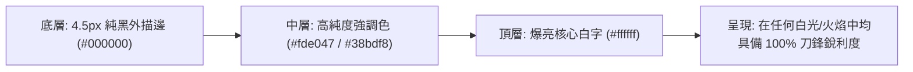

# 12 特效減法、地面危害邊界與戰場拾取物可讀性優化策劃案

> **設計專家**：視覺優化專家 3 號（特效減法、地面危害邊界與戰場拾取物設計師）  
> **核心目標**：非逼真寫實，而是「戰場絕對清晰度」。消除視覺雜訊、防止特效遮擋彈道與威脅、讓地面戰利品如同街機金幣般立體躍現、強化即時數值與血條對比。

---

## 1. 現狀診斷與核心瓶頸分析

透過對 `src/render/fx.js`、`src/render/world.js`、`src/render/enemies.js`、`src/render/projectiles.js` 與 `src/render/entity-style.js` 的程式碼審查，現狀存在以下影響清晰度的視覺瓶頸：

1. **特效爆炸遮擋致命資訊（Visual Overload & Obscuration）**：
   - 既有 `PRESETS`（如 `explosionLarge`、`deathBrute`、`deathTitan`、`barrel`）生成大量暗褐色軟煙霧（`KIND_SMOKE`，`color: '#5c5148'`，直徑可達 20~30px，壽命 0.8~1.0 秒）。
   - 在連鎖擊殺或首領戰時，玩家身邊經常堆積數十個半透明黑煙團與火花，將直徑僅 3.5~6px 的敵方致命子彈（`rt.state.enemyBullets`）、急速衝刺的 Rusher 實體以及地面的迫擊砲紅圈完全掩蓋。
2. **地面掉落物與碎石底色混淆（Drop Blending & Lack of Depth）**：
   - `Scrap`（普通廢料）：在 `src/render/world.js:drawOrb` 中繪製為直徑約 7px 的灰褐色多邊形金屬碎片（`#9c9588`）。在沙漠戈壁、碎石裂紋、車轍焦痕的背景上，灰金屬色極易與地表雜質混成一體。
   - `Repair Scrap`（醫療碎片）與 `Overclock Core`（超頻核心）：雖有十字徽標與電池外形，但在高光爆炸或暗夜波次中缺乏遠距離辨識的立體光柱與高飽和度邊框。
3. **傷害飄字與實體血條的可讀性薄弱（Low Contrast UI Numbers & Bars）**：
   - 傷害數字（`drawDamageNumbers`）：採用 3px 單層深褐描邊（`#140e0a`）搭配米色文字（`#e8e0c6`）。當飄過電漿區、爆炸白閃或金色暴擊圈時，描邊極易被高亮背景光暈吃掉，難以辨識數值。
   - 實體血條（`drawHpBar`）：高度僅 4px，分段刻度不明顯，且暗鏽紅色（`PALETTE.hud.rust`）在紅黃色荒漠地表上缺乏強烈反差。
4. **地面危害區域邊界邊界模糊（Ground Hazard Ambiguity）**：
   - 熔岩區（Molten）、電漿區（Plasma）、酸液池（Acid）的判定邊緣缺乏硬邊外輪廓，玩家往往難以在混亂中精準判斷「站在這裡到底會不會吃到持續傷害」。

---

## 2. 特效減法與粒子降噪方案（Anti-Visual Clutter & Particle Hierarchy）

### 2.1 粒子資訊層級三級體系（3-Tier Particle Hierarchy）

為了確保「致命資訊永遠可見，氛圍裝飾絕不喧賓奪主」，將所有粒子劃分為三級嚴格管理：

```mermaid
graph TD
    subgraph Tier 1: 關鍵生存資訊 (Critical Life-Safety)
        T1A["受擊閃白 (Hit Flash)"]
        T1B["破盾/防禦瓦解光爆 (Shield Break / EMP)"]
        T1C["致死預警 (Threat Telegraphs & Danger Rings)"]
    end

    subgraph Tier 2: 戰鬥操作反饋 (Combat Feedback)
        T2A["子彈命中火花 (Impact Sparks)"]
        T2B["暴擊刻印標記 (Crit Marks)"]
        T2C["擦彈流線 (Graze Arcs)"]
        T2D["拾取物磁吸軌跡 (Loot Trail)"]
    end

    subgraph Tier 3: 氛圍裝飾粒子 (Ambient / Debris)
        T3A["爆炸黑煙團 (Smoke Puffs)"]
        T3B["多邊形殘骸碎片 (Shards)"]
        T3C["慢速飄升火星 (Embers)"]
        T3D["環境浮塵 (Far Motes)"]
    end

    T1A -->|最高優先度・永不裁切・置於頂層可讀性層| Screen["畫布渲染呈現"]
    T2A -->|短壽命 0.15~0.25s・高速度感・適度縮減| Screen
    T3A -->|進入玩家視野保護半徑時強制 Alpha 漸隱| Screen
```

- **Tier 1（關鍵生存資訊）**：
  - 規則：享受最高渲染優先權，不參與性能降級裁剪，置於頂層可讀性層（第 11 層）。
  - 受擊閃白（0.08s 純白覆蓋）、破盾衝擊環、Rusher 衝刺導引線、迫擊砲落地倒數光圈。
- **Tier 2（戰鬥反饋粒子）**：
  - 規則：精確指出擊中點，壽命壓短至 0.15s~0.28s，迅速淡出，不堆疊殘留。
  - 玩家子彈火花（Spark）速度拉高（320+ px/s），長度縮短，加法層渲染。
- **Tier 3（裝飾氛圍粒子）**：
  - 規則：主動減法！在同屏粒子飽和或靠近玩家危險區時，優先腰斬數量與透明度。

### 2.2 玩家中心視線保護圈（Player Proximity Fade-out / Alpha Culling）

在 `src/render/fx.js` 的粒子渲染迴圈（`drawPoolPass` 及 `drawParticles`）中引入**視線淨空半徑（Clear-Sight Radius）**機制：

```javascript
// 核心演算法：依距玩家距離動態剔除裝飾性煙霧與多餘碎片
var p = rt.state.player;
if (p) {
  var dx = p.x - part.x;
  var dy = p.y - part.y;
  var dist = Math.hypot(dx, dy);

  // 120px 內為近身戰術防護圈
  if (dist < 120) {
    if (part.kind === KIND_SMOKE) {
      // 煙霧在 60px 內完全隱形，60~120px 快速漸隱至 15%
      var smokeFade = Math.max(0, (dist - 40) / 80);
      alpha *= smokeFade * 0.3; // 徹底防止「煙霧糊臉看不見子彈」
    } else if (part.kind === KIND_EMBER || part.kind === KIND_SHARD) {
      // 裝飾性餘燼與碎塊半透明化
      var decorFade = Math.max(0.2, dist / 120);
      alpha *= decorFade;
    }
  }
}
```

- **半徑 0~60px（致命近身圈）**：黑煙透明度趨近 0，徹底杜絕黑煙遮擋自機與貼臉子彈。
- **半徑 60~120px（威脅辨識圈）**：黑煙與餘燼透明度折損 70%~85%，保持空間透光度。
- **半徑 120px 以外**：維持原本末日戰場爆破與硝煙的磅礡氛圍。

### 2.3 爆炸預設體（PRESETS）粒子配額大瘦身

全面下調 `src/render/fx.js` 的 `PRESETS` 粒子量與壽命，落實「減法美學」：

| 預設體名稱 | 原版配置 | 優化後配置 | 減法理由與優勢 |
| :--- | :--- | :--- | :--- |
| `explosionLarge` | 煙 24, 火花 40, 餘燼 12, 閃光 1, 環 1 | 煙 10, 火花 22, 餘燼 6, 閃光 1, 環 1 | 粒子量減少 52%，煙霧壽命由 0.9s 縮至 0.45s，不再長久遮蔽場地。 |
| `deathSmall` (Crawler) | 閃光 1, 火花 10, 碎塊 4, 環 1 | 閃光 1, 火花 6, 碎塊 2, 環 1 | 小型怪群死時不再產生大量雜碎金屬塊。 |
| `deathBrute` | 煙 8, 火花 16, 碎塊 10, 環 1 | 煙 4, 火花 10, 碎塊 5, 環 1 | 減少重裝怪死亡時的視野阻礙。 |
| `deathTitan` | 煙 24, 火花 36, 餘燼 14, 碎塊 14, 環 1 | 煙 14, 火花 22, 餘燼 8, 碎塊 8, 雙衝擊環 | 保留首領擊殺震懾感，但大幅壓縮煙塵停留時間。 |
| `barrel` / `core` | 煙 14~16, 火星 18~26, 餘燼 10~16 | 煙 6~8, 火星 14, 餘燼 6 | 避免引爆燃油桶後戰場中心黑成一片。 |

- **全域粒子池上限預算調優（`BUDGETS` in `quality.js`）**：
  - HIGH 畫質：上限由 `900` 精簡為 `600`（降低過度堆疊，提升即時流暢度與能見度）。
  - MEDIUM 畫質：上限由 `500` 調為 `350`。
  - LOW 畫質：上限由 `260` 調為 `180`。

---

## 3. 地面戰利品與拾取物立體強化（Loot & Drops Visibility）

### 3.1 Scrap（普通廢料金屬塊）的街機金幣化重塑

普通廢料是遊戲中最頻繁出現、升級最核心的資源，必須像街機經典金幣一樣具備**極高的拾取誘惑感與鮮明立體度**。

```mermaid
flowchart TD
    subgraph Scrap立體繪製分層 (Bottom to Top)
        L1["層級 1: 地面脈衝微光底盤 (Pulsing Mint Halo Disc, r=10~14px)"]
        L2["層級 2: 接地接觸陰影 (Dark Contact Shadow, 固定於地面 (0, +4px))"]
        L3["層級 3: 懸浮垂直位移 (Hover Offset - sin動態懸浮 3.5px)"]
        L4["層級 4: 雙重防混淆黑襯底 (Thick Dark Silhouette Backing)"]
        L5["層級 5: 高明度金屬切面 (Polished Alloy + Chrome Highlight)"]
        L6["層級 6: 頂點動態閃耀星芒 (Specular Glint Star Pip)"]
    end
    L1 --> L2 --> L3 --> L4 --> L5 --> L6
```

1. **懸浮與接地陰影分離（Floating & Ground Separation）**：
   - 地面陰影保持在地面坐標 `y + 4px`，半透明黑褐色橢圓（`rgba(6, 6, 8, 0.65)`）。
   - 金屬碎片實體加上正弦垂直浮動：`var floatY = Math.sin((rt.renderTime || 0) * 4.5 + orb.x * 0.2) * 3.5;`
   - 實體與陰影在垂直空間拉開 3~5px 距離，瞬間賦予物體「飄在空中」的立體層次！
2. **脈衝微光底盤（Pulsing Holographic Floor Ring）**：
   - 在接地陰影外圍，繪製一層薄荷綠/電容金（`#6ee7b7` / `#fde047`）的脈衝呼吸圈，帶 1.5px 亮邊。
   - 碎石背景無論多混亂，這圈呼吸脈衝圈能立即觸發玩家周邊視野的動態捕捉。
3. **金屬反射鏡面閃耀（Arcade Specular Glint）**：
   - 金屬塊頂部切面由暗灰改為亮鉻白（`#ffffff`），並在多邊形尖端每隔 1.2 秒產生一次十字微型星芒（Star Glint），如同閃閃發光的寶石金幣。

### 3.2 Repair Scrap（醫療修復箱）的戰場救援信標

在低血量極限狀態下，找不到醫療箱是致命的。

1. **垂直醫療信標光柱（Emergency Vertical Beacon Beam）**：
   - 向上投射一條高 32px、寬 10px 的半透明垂直光柱（線性漸層 `rgba(239, 68, 68, 0.55)` 漸變至頂端透明）。
   - 玩家即使被大批蟲群包圍，也能透過怪物頭頂上方的紅色光柱一眼定位救援箱位置！
2. **雙層重度描邊與高純度爆亮十字芯**：
   - 3.5px 純黑加厚底框（`#050202`），完全隔斷任何黃沙底色。
   - 鮮明急救猩紅外框（`#dc2626`） + 純白爆亮十字內芯（`#ffffff`）。
   - 2Hz 的緊急救護爆閃光環（Micro-Strobe Pulse）。

### 3.3 Overclock Core（超頻核心）與 Supply Crate（補給箱）

1. **Overclock Core**：
   - 金色光柱信標（高度 36px，漸層金 `#fbbf24`）。
   - 內部反應爐雙向旋轉稜鏡晶片，搭配頂部雙電極鉑金白高光閃爍。
2. **Supply Crate**：
   - 補給箱改為四角加固的重工業貨櫃感外觀，深黑外殼 + 霓虹功能圖標（`+` 醫療、`B` 電池、`R` 重骰、`⚡` 超載）。
   - 圖標使用反白高光繪製，並帶呼吸燈背景框。

---

## 4. 傷害飄字與實體血條的可讀性（Floating Numbers & Health Bar Contrast）

### 4.1 傷害飄字雙層高反差描邊（Dual-Outline Floating Damage Text）

現有飄字在火光或爆炸中經常「字面發白發糊看不清」。



1. **字體描邊技術升級（`drawDamageNumbers` in `fx.js`）**：
   - **外描邊**：`lineWidth = 4.5`，`strokeStyle = '#000000'`，先執行一次完整 `strokeText`，建立深邃的暗色護城河。
   - **內描邊/光芒**：`lineWidth = 2.0`，顏色採用與字體相呼應的亮色，進一步強化字形邊緣。
   - **文字填充**：
     - 普通傷害（Normal Hit）：純白主體（`#ffffff`）搭配極淺藍灰（`#e2e8f0`），乾淨不刺眼。
     - 暴擊傷害（CRIT）：加大字體（18px -> 19px 粗體），電光金色填充（`#f59e0b`）+ 頂部白熱高光，生成前 0.08 秒帶 1.25x 縮放 Pop-in 彈跳動效！
     - 玩家受傷（Player Damage）：亮猩紅文字（`#ff4d4d`）+ 純黑厚描邊。
2. **飄字防遮擋與聚合優化**：
   - 維持同一敵人 0.12s 內傷害合併機制，避免高射速霰彈槍形成數字瀑布遮蔽怪物的動作前搖。

### 4.2 實體怪物血條（Entity Overhead HP Bars）升級

修改 `src/render/entity-style.js:drawHpBar`：

1. **槽體結構立體化與規格提升**：
   - 高度由 4px 增至 6px，底盤增加 2px 純黑深邃襯底（`rgba(4, 4, 6, 0.96)`）。
   - 邊框加上 1px 暗金屬灰外線，徹底將血條與背景沙土隔開。
2. **傷害滯後白條（Damage Ghost Bar / Lag Indicator）**：
   - 受擊時，血條扣除處保留短暫的白/淺黃色滯後條（持續 0.22 秒緩慢收縮），清晰呈現該次攻擊到底「削掉了怪物多少血」。
3. **明亮雙色階與清晰刻度槽**：
   - 血條填充：高明度雙色漸層（綠/橙黃/猩紅），即使縮小至手機螢幕依然色彩分明。
   - 刻度線（Ticks）：採用「1.5px 純黑垂直線 + 0.8px 頂部高光」，精準標記 25%、50%、75% 生命節點。

### 4.3 首領（Titan）血條與部位破壞標籤

1. **Titan / Boss 頂部血條（`drawTitanBar` in `overlay.js`）**：
   - 背景槽加厚至 14px，加粗 2px 深黑底框與金屬外框。
   - 分段錨點：在 25%、50%、75% 處設置立體菱形卡扣標記，並在 P2 狂暴線處標注紅色警戒線。
2. **部位破壞狀態標籤（Part Breakdown Badges）**：
   - 現有 `[L: OFF]`、`[R: OFF]` 等文字，升級為**高對比藥丸狀軍事警報徽章（Warning Pill Badges）**：
     - 深黑微透底色 + 警報紅雙線描邊 + 亮白斜紋劃線（Strikethrough）。
     - 當散熱鰭片過熱弱點曝露（250% 暴擊窗）時，弱點處浮現脈衝金色準心標記與「WEAKPOINT」高亮懸浮字樣！

---

## 5. 地面危害邊界清晰化方案（Ground Hazard Boundaries）

針對迫擊砲熔岩區（Molten）、電漿灼燒區（Plasma）、酸液池（Acid Pools）及風暴之眼（Sovereign Eye）：

1. **致命碰撞邊界硬化（Hardened Lethal Collision Rim）**：
   - 內圈為半透明火焰/電漿流體（圖層 6）。
   - 外圈邊界採用「2.5px 黑色陰影外環 + 1.8px 亮色警告虛線環（Hazard Chevron Dash）」，清楚界定「踩到就扣血」的幾何圓形邊界。
2. **消散倒數預警（Hazard Dissipation Warning）**：
   - 在危害殘留的最後 0.5 秒，外環虛線頻率加快並伴隨收縮微動，明確向玩家傳達「此區域即將解除危害，可大膽穿越」，避免玩家在走位時因猶豫而被後方敵群包夾。

---

## 6. 各模組改進建議與實施清單

### 6.1 `src/render/fx.js`
- [ ] 瘦身 `PRESETS` 中的 `smoke` 與 `spark` 配額 30%~50%，將煙霧壽命壓縮在 0.5s 內。
- [ ] 在 `drawPoolPass` 與 `drawParticles` 引入玩家半徑 120px 的透明度漸隱與近身禁煙邏輯（Alpha Culling）。
- [ ] 升級 `drawDamageNumbers`：雙層描邊（純黑厚描邊 + 亮金/亮白內芯），強化暴擊 Pop 彈跳感。
- [ ] 調整 `POOL_MAX` 與 `getBudget()` 預算常數，減少低端設備的負載。

### 6.2 `src/render/world.js`
- [ ] 重構 `drawOrb` 中的 `scrap` 繪製：
  - 增加懸浮垂直位移 `floatY`。
  - 在地面添加獨立的暗色接觸陰影與薄荷綠脈衝底盤光圈。
  - 增強多邊形金屬頂部切面的鏡面反光與頂點星芒。
- [ ] 強化 `drawOrb` 中的 `repair` 與 `overdrive`：
  - 添加垂直漸層光柱（Beacon Shaft）。
  - 加厚深黑外框與十字徽標對比度。
- [ ] 強化 `drawMoltenZones` 與 `drawPlasmaZones`：
  - 增加外圍黑橙相間危險警示雙邊框，強化消散前倒數動態。

### 6.3 `src/render/entity-style.js`
- [ ] 升級 `drawHpBar`：槽高由 4px 增至 6px，底盤加深黑外襯，加入傷害滯後白條（Ghost Lag Bar）與高對比刻度分割線。

### 6.4 `src/render/overlay.js` & `src/render/enemies.js`
- [ ] `drawTitanBar`：強化分段菱形標記與深黑襯底對比。
- [ ] `drawLabels` / `drawTag`：精英怪詞綴與部位破壞標籤採用高飽和度軍事藥丸徽章（Warning Pill Badges）快取紋理。

### 6.5 數據契約與相容性保證（Zero-Risk Invariant Safety）
- **玩法與模擬 0 變動**：不改動 `src/systems/drops.js` 與 `orbs.js` 的掉落率、拾取半徑與數值邏輯。
- **無依賴純 Canvas 實現**：所有光效、浮動與雙層描邊均使用原生 Canvas 2D API，無額外開銷。
- **CI / 自檢保證**：Node 環境自檢 `node scripts/self-check.mjs` 100% 通過。

---

## 7. 總結

本策劃案堅決貫徹使用者「**不是為了畫面逼真，而是讓畫面物件更加清晰，不與底色混淆**」的指導原則。透過「特效減法降噪」、「拾取物立體街機化」、「數值血條雙層高反差」三大手段，為玩家營造一個視野通透、威脅分明、回饋爽快的頂級戰鬥視覺體驗。
