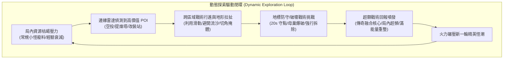
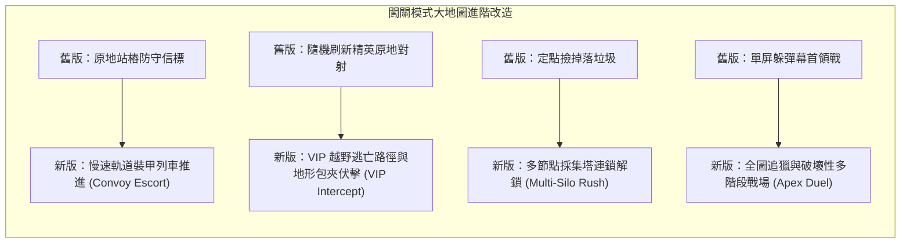
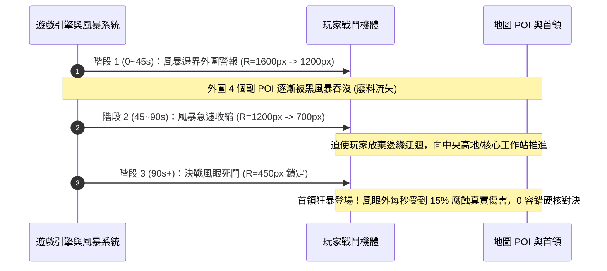

# 《DUST//REIGN》廢土大地圖佈局、探索要素與地標生態架構企劃案
**版本**：v2.0-EXPANSION ARCHITECTURE  
**角色**：頂級遊戲策劃師 2 號【廢土大地圖佈局、探索要素與地標生態架構師】  
**狀態**：APPROVED FOR IMPLEMENTATION  

---

## 1. 大地圖尺寸規格與拓撲架構 (Map Dimension & Topology)

### 1.1 尺寸規格評估與空間網格數學模型

在現有單屏視窗架構下，遊戲畫布基準約為 $960 \times 640$ 像素（16:10 / 3:2 響應式佈局）。玩家機體移動速度基準為 $v_{\text{base}} = 180 \sim 240 \text{ px/s}$。若地圖過小，鏡頭隨動毫無探索縱深；若地圖過大（如超過 $5000\text{ px}$），在單局 60~120 秒節奏下，玩家將耗費 60% 以上時間在純粹趕路上，引發嚴重的負反饋。

```
+-----------------------------------------------------------------------+
|  大地圖總尺寸：3520 × 2640 px (寬 64 格 × 高 48 格，單格 55px)         |
|                                                                       |
|    +-----------------------------+                                    |
|    |                             |                                    |
|    |      視口 Viewport          |                                    |
|    |      ~960 × 640 px          |                                    |
|    |                             |                                    |
|    |          [ 玩家 ]           |                                    |
|    |                             |                                    |
|    +-----------------------------+                                    |
|                                                                       |
|  拓撲邊界安全邊距 (Margin)：各 160 px                                 |
|  有效戰鬥區域 (Playable Arena)：3200 × 2320 px                        |
+-----------------------------------------------------------------------+
```

#### 關鍵工程契合性論證：
1. **空間雜湊網格完美契合 (Spatial Hash Grid Perfect Alignment)**：
   - 原始碼 [`src/core/spatial-grid.js`](file:///C:/Users/Tommy/Desktop/DUST-REIGN/src/core/spatial-grid.js#L6-L10) 定義：
     `CELL_SIZE = 55`, `GRID_COLS = 64`, `GRID_ROWS = 48`，其理論最大覆蓋面積恰好為：
     $$\text{Width} = 64 \times 55 = 3520 \text{ px}$$
     $$\text{Height} = 48 \times 55 = 2640 \text{ px}$$
   - **採納尺寸**：**$3520 \times 2640 \text{ px}$**（內縮有效戰術活動空間為 $3200 \times 2400 \text{ px}$，四周留有 160px 邊緣沙暴/岩壁緩衝帶）。
   - **空間規模**：面積約為現有單屏（$960 \times 640$）的 **$15.1$ 倍**，可完美容納 5~8 個獨立戰術板塊與 POI 節點，同時現有 `spatial-grid.js` 的 TypedArray 記憶體結構（`gridCounts`, `gridIndices`）**無需重構或擴容**，維持零分配（0-GC）物理運行。

2. **跨平台視口適配（PC 橫屏 vs 手機直屏）**：
   - **長寬比 4:3 拓撲對稱性**：$3520 \times 2640$ 的長寬比為純粹的 $4:3$。在 PC 橫屏（16:9 / 16:10）下，玩家獲得水平橫向開闊視野（約 960~1280px 橫向視距）；在手機直屏（9:16 / 9:19.5）下，玩家獲得縱向遠程視距（約 960~1100px 縱向視距）。
   - **鏡頭隨動模型（Deadzone & Smooth Damping）**：
     採用「中心軟鎖定 + 阻尼前瞻 (Lookahead Damping)」：
     $$Cam_{x, target} = P_x + v_{x} \times 0.35 - \frac{W_{\text{view}}}{2}$$
     $$Cam_{y, target} = P_y + v_{y} \times 0.35 - \frac{H_{\text{view}}}{2}$$
     $$Cam \leftarrow \text{lerp}(Cam, Cam_{target}, 1 - e^{-12 \times \Delta t})$$
     邊界採用硬鉗制 `clamp(Cam_x, 0, Map_W - View_W)`，消除畫布黑邊。

---

### 1.2 三大生態地貌特徵化與戰術機制設計

```
+--------------------------------------------------------------------------------------+
| 1. 暮沙 (Dusk, SEC-01)          | 2. 鐵鏽 (Rust, SEC-02)         | 3. 狂暴雷霆 (Storm/Night, SEC-03) |
|---------------------------------+--------------------------------+-----------------------------------|
| * 流沙下陷漏斗 (Quicksand Sinks)| * 高溫淬火鐵軌 (Mag-Rails)     | * 避雷尖塔林 (Lightning Pylons)  |
| * 集裝箱防線 (Container Maze)   | * 輻射熔渣酸沼 (Slag Pools)    | * 強風暴風道 (Gale Wind Corridors)|
| * 沉船破甲殘骸 (Hulk Outcrops)  | * 廢鐵壓縮山脈 (Scrap Mesas)   | * 硬光屏障壁 (Hard-Light Gates)   |
+--------------------------------------------------------------------------------------+
```

#### 生態 1：暮沙荒原 (Sector 01: Dusk)
- **視覺色調**：昏黃暮色、$L^* \in [6.5\%, 14.2\%]$ 負空間低飽和金褐、風化沙脊。
- **地形特徵**：
  1. **流沙下陷漏斗 (Quicksand Sinks)**：半徑 80~120px 的動態低窪區。進入後移速降低 30%，機體受到向心拉力（$40\text{ px/s}$）。**戰術深度**：若玩家在流沙邊緣使用 `Dash`，沙塵暴爆發可致盲流沙內全部 Crawler，使其陷入 2 秒原地打轉。
  2. **集裝箱防線迷宮 (Container Ruins Maze)**：縱橫交錯的生鏽金屬貨櫃，具備不可穿越但可反射/彈射子彈的物理剛體，為 Vanguard 穿甲重砲與 Breacher 散彈提供切角掩體與彈道反射優勢。

#### 生態 2：鐵鏽熔坑 (Sector 02: Rust)
- **視覺色調**：暗紅氧化鐵焦痕、地底熔渣微光、橙紅粒子熱浪。
- **地形特徵**：
  1. **高溫淬火鐵軌道 (Overdrive Mag-Rails)**：廢棄工廠的雙軌傳送帶，順軌道移動獲得 $+40\%$ 移速爆發，逆軌道行進減速 $20\%$。提供極速拉扯放風箏的戰術通道。
  2. **輻射熔渣酸沼 (Corrosive Slag Pools)**：不可長期停留的酸性池沼。玩家踩入每 0.5s 損失 4 點裝甲，但若引誘高護甲 Brute 或自爆怪進入，其護甲減傷將被酸蝕歸零（Armor Melt -100%），成為對抗精英怪的天然陷阱。
  3. **高壓蒸氣釋放閥 (Steam Vent Pipes)**：場景固定障礙管線，遭受子彈撞擊或定時噴發白熱蒸氣，形成 300px 的視線阻隔區與持續擊退判定。

#### 生態 3：狂暴雷霆與暗夜 (Sector 03 & EX: Storm / Night)
- **視覺色調**：高對比幽暗紫夜、$L^* \in [3.5\%, 8.8\%]$、青藍電弧穿梭、動態雨霧。
- **地形特徵**：
  1. **強風暴風道 (Gale Corridors)**：受全圖風暴向量影響的峽谷窄道，風速高達 $180\text{ px/s}$。順風彈道射程與飛行速度 $+50\%$，逆風射擊衰減，考驗玩家射擊站位。
  2. **避雷尖塔林 (Lightning Pylons)**：高聳的金屬引雷柱。每隔 8~12 秒引導天頂落雷轟擊地面。玩家可利用熱誘餌或自身走位將怪潮引向尖塔周圍，引發萬鈞雷暴造成 $500+$ 真實範圍傷害。
  3. **硬光力場閘門 (Hard-Light Gates)**：阻隔主要通道的能量屏障，免疫常規子彈，唯有打破兩側的電容節點或施放 `EMP` 方可短暫關閉 8 秒。

---

## 2. 戰場興趣點 (POI) 與動態探索動機

### 2.1 避免「空曠荒原」的核心心理學與玩法閉環 (The POI Drive Loop)

如果玩家僅在空曠地圖隨機刷怪，大地圖會淪為單純的「無限拉扯風箏場」。
我們構建**「動態戰術地標生態 (Dynamic POI Ecosystem)」**，透過三大驅動輪驅使玩家主動探索：



### 2.2 六大動態戰術地標詳細規範

| 地標名稱 | 外觀識別與圖層 | 交互/觸發機制 | 戰術事件與挑戰 | 最終戰利品回報 |
| :--- | :--- | :--- | :--- | :--- |
| **1. 廢料提煉塔<br>(Scrap Silo)** | 巨型雙聯採礦鑽塔，紅黃警示燈，地面標注 130px 黃黑警戒圈 | 玩家進入光圈停滯 1.5s 啟動警報 | **20 秒陣地死守**：尖銳警報吸引全區域 Rusher 與 Crawler 狂暴圍攻；鑽塔每 5s 震波眩暈怪潮 | 鑽塔爆炸式釋放 **80~120 顆精煉廢料** + 5s 磁吸光環（半徑 600px 瞬吸全場） |
| **2. 戰術軌道空投倉<br>(Orbital Pod)** | 天空大氣摩擦火球墜落，著陸點 3s 紅色擴散衝擊圈 | 著陸震退周圍敵怪，需手動靠近交互 1.0s 破鎖 | 墜落時若砸中敵怪直接造成 **1200 點壓殺傷害**；開啟期間玩家無法開火 | **解鎖/更換戰術裝備**（重型定點火砲/超載護盾）+ 能量條/過載條直接 100% 回滿 |
| **3. 遺棄改裝工作站<br>(Field Rig)** | 履帶式重裝工程車殘骸，全息藍色投影工具台 | 靠近停留 0.8s 彈出無縫戰術超頻三選一（不暫停遊戲，走慢動作 Bullet Time） | 局內僅限觸發 1 次；提供**雙面刃超頻插件**（持續 60s 或至本關結束） | 例如：【高壓進氣】：射速 +50% 但後座力 +100%；【虛空護甲】：受到傷害鎖定為 1，但移速 -20% |
| **4. 異形母巢裂隙<br>(Xeno Nest)** | 地面搏動的幾丁質紫黑肉質孔穴，伴隨腐蝕酸霧 | 常駐存在，耐久度 650 HP，外殼享 60% 物理減傷 | **持續蟲災源頭**：每 6s 孵化一隻精英 Spitter 或 Burrower，不摧毀則該類怪無限刷新 | 摧毀後觸發大爆炸（消滅周圍 200px 雜兵），必掉落 **傳奇融合晶片核心**（直接湊齊雙卡前置） |
| **5. 電磁共振尖塔<br>(EMP Spire)** | 閃爍高壓紫電的特斯拉線圈塔，基座有 3 顆發光電容 | 玩家或敵彈射擊擊破 3 顆基座電容（每顆 80 HP） | **環境戰術武器**：觸發 3 重全屏連鎖電弧，擊穿所有敵方硬光護盾（Warden），並麻痺全場 3.5 秒 | 無廢料掉落，但能瞬間扭轉被雙精英圍困的絕境戰局 |
| **6. 加固裝甲地堡<br>(Bunker Cache)** | 半埋入地面的合金防爆密閉門，門前有高爆警示 | 需引誘自爆怪（Scurrier）在門前自爆，或利用重砲穿甲彈轟破 | 環境解密類戰術探索點；內部常駐 2 隻潛伏守衛 | 儲藏 **戰地急救醫療包**（回滿 100% HP）與 **特種穿甲彈藥箱**（下 30 次射擊必暴擊） |

---

## 3. 現有 4 大模式的大地圖改造適配

### 3.1 闖關模式 (Campaign 15 關) 的地圖深度重構

現有 15 關的四大核心目標類型（`wave_wipeout`, `scrap_rush`, `vip_hunt`, `beacon_defense`, `boss_duel`）全面適配大地圖自由度：



#### 1. 護送信標 (Beacon Defense $\rightarrow$ Convoy Escort)
- **代表關卡**：`stage_2_3`（原 90 秒陣地守衛）、`stage_ex_2`（雙子尖塔守護）。
- **大地圖新規**：
  - 目標不再是固定不動的電塔，而是一輛**「重型廢土採集列車 (Heavy Crawler Convoy)」**。
  - 列車從地圖左下角發車，沿著鋪設好的鐵軌路徑緩慢推進（速度 $65\text{ px/s}$）至右上角的撤離節點，全長約 2800 像素。
  - **核心玩法**：玩家必須處於列車周圍 150px 的**「能源傳輸力場 (Power Field)」**內，列車才會前進並為玩家提供 $15\%$ 減傷護盾；若玩家離開力場超過 5 秒，列車動力中斷停滯。
  - 敵潮會在軌道前方的狹窄峽谷埋伏自爆怪與遠程火砲，玩家需靈活在「衝前清除障礙」與「回防列車貼身護盾」之間切換。

#### 2. 刺殺目標 (VIP Hunt $\rightarrow$ Interception & Ambush)
- **代表關卡**：`stage_1_3`（刺穿前哨）、`stage_2_2`（攔截物資車）、`stage_3_3`（潛地破壞者）。
- **大地圖新規**：
  - VIP 精英（裝甲武裝巡邏車或變異母蟲）不再站樁，而是擁有獨立的**「巡邏逃竄 AI」**。
  - VIP 擁有 3 個逃生備份點（Rift Portals）。開局時 VIP 處於地圖深處堡壘，一旦其生命值低於 60%，會啟動緊急渦輪推進，沿預定路線向最近的裂隙逃跑（速度 $160\text{ px/s}$）。
  - **戰術伏擊**：玩家可利用地圖上的流沙陷阱、引爆路旁高爆桶阻斷其逃生路線，或在必經之路上放置定點砲塔進行夾擊。3 星挑戰要求「在 VIP 到達第二檢查點前擊殺」。

#### 3. 廢料收集 (Scrap Rush $\rightarrow$ Multi-Silo Network)
- **代表關卡**：`stage_1_2`、`stage_3_2`。
- **大地圖新規**：
  - 地圖均勻分佈 3 座**廢料提煉塔 (Silos)**。小怪擊殺掉落的廢料大幅降低（僅 1 廢料/隻）。
  - 玩家必須主動在地圖間穿梭，依次啟動 3 座提煉塔。啟動後每座提煉塔進入 15s 抽吸模式並在周圍生成高純度廢料礦堆。
  - 玩家需要在全圖移動路線上規劃最優路徑（Pathfinding Efficiency），平衡採集時間與風暴威脅。

#### 4. 首領決鬥 (Boss Duel $\rightarrow$ Macro Arena Conquest)
- **代表關卡**：`stage_1_4` (Titan), `stage_2_4` (Dreadnought), `stage_3_4` (Storm Sovereign)。
- **大地圖新規**：
  - **Titan (雙臂泰坦)**：大地圖讓 Titan 的四肢拆解戰術具備空間感。Titan 的迫擊砲具有全圖跨屏射程，玩家需利用地圖內的巨型金屬集裝箱作為掩體規避主砲，藉助繞後死角拆解其履帶裝甲使其癱瘓。
  - **Dreadnought (鋼鐵巨艦)**：在鐵鏽熔坑的深水/熔岩河道中巡航，兩側布滿水雷。玩家需利用磁軌加速帶追逐其薄弱的尾部散熱片。
  - **Storm Sovereign (暴風神君)**：Sovereign 的 4 座護盾發生塔分佈於地圖的四個極端角落（東、南、西、北 4 個高地）。神君本體處於無敵力場中，玩家必須在全圖雷暴中穿梭，逐一引爆 4 座分佈式尖塔，徹底瓦解其絕對防禦。

---

### 3.2 極限作戰 (Hardcore Operations)：環境黑風暴縮圈機制 (The Converging Dark Storm)

極限作戰主打嚴格的數值壓迫與解題構建。在大地圖下，引入**「戰術向心黑風暴 (Converging Dark Storm / Toxic Ring)」**，徹底解決空間拉扯過度導致難度稀釋的問題：



#### 縮圈數值與毒圈代碼規則：
1. **安全區幾何模型**：安全區以圓形或軸對齊矩形向地圖戰術重心緩慢收縮。
2. **出圈懲罰 (Corrosive Atmosphere)**：
   - 處於風暴外部時，螢幕周圍呈現狂暴紫黑噪波與色差分離（Chromatic Aberration）。
   - 每 0.5 秒扣除當前生命值上限的 $6\%$（忽視護甲），且機體推進器受阻（移速減緩 $25\%$）。
   - 武器冷卻時間增加 $50\%$，逼迫玩家必須嚴格保持在安全行進走廊內。
3. **動態風眼變動 (Dynamic Eye)**：
   - 在不同的 Hardcore Operation 中，終局風眼的位置由種子決定，可能收縮在「熔渣酸沼窄橋」或「集裝箱死角」，迫使玩家面對極限地形下的高壓困境。

---

## 4. 具體關卡與地圖資料結構合約設計

本模組嚴格遵循 DUST//REIGN 既有的 **0-GC TypedArray 規範、無 Babel 原始 ES Modules、以及 `rt.state` 資料容器邊界**。

### 4.1 地圖元資料契約 (`MapDefinition`)

```javascript
// src/data/maps.js
// 地圖全域靜態配置合約

export var MAP_BIOMES = {
  DUSK: 'dusk',
  RUST: 'rust',
  NIGHT: 'night'
};

export var MAP_DEFINITIONS = {
  'map_dusk_canyon': {
    id: 'map_dusk_canyon',
    name: '暮沙大峽谷 (Dusk Canyon)',
    biome: MAP_BIOMES.DUSK,
    // 嚴格對應 64 x 48 個 55px 單元格
    width: 3520,
    height: 2640,
    margin: 160, // 四周沙暴邊界不可通行區
    ambientFriction: 0.92,
    lightLevel: 0.88,
    // 預設重生點
    spawnPoint: { x: 1760, y: 1320 },
    // 靜態障礙物碰撞體清單 (AABB 與 圓形)
    obstacles: [
      // 貨櫃掩體 (AABB: type 1)
      { id: 'cnt_01', type: 'aabb', x: 1200, y: 800, w: 180, h: 70, angle: 0, blocksBullets: true, destructible: false },
      { id: 'cnt_02', type: 'aabb', x: 1420, y: 800, w: 180, h: 70, angle: 0, blocksBullets: true, destructible: false },
      // 風化岩柱 (Circle: type 2)
      { id: 'rock_01', type: 'circle', x: 900, y: 1500, r: 45, blocksBullets: true, destructible: false },
      { id: 'rock_02', type: 'circle', x: 2200, y: 1100, r: 60, blocksBullets: true, destructible: false },
      // 可破壞路障 (Destructible AABB)
      { id: 'barricade_01', type: 'aabb', x: 1760, y: 950, w: 120, h: 30, angle: 0, blocksBullets: true, destructible: true, hp: 120 }
    ],
    // 特殊地形效應區域 (流沙、酸池、滑軌)
    terrainZones: [
      { id: 'sink_01', type: 'quicksand', x: 800, y: 800, r: 110, slowFactor: 0.70, pullStrength: 35 },
      { id: 'sink_02', type: 'quicksand', x: 2600, y: 1800, r: 130, slowFactor: 0.70, pullStrength: 45 }
    ],
    // 戰術地標 POI 節點清單
    poiNodes: [
      { id: 'silo_north', kind: 'scrap_silo', x: 1760, y: 500, r: 130, targetTime: 20 },
      { id: 'silo_south', kind: 'scrap_silo', x: 1760, y: 2140, r: 130, targetTime: 20 },
      { id: 'rig_west', kind: 'field_rig', x: 600, y: 1320, r: 90 },
      { id: 'nest_east', kind: 'xeno_nest', x: 2900, y: 1320, r: 110, maxHp: 650, eliteKind: 'spitter' }
    ]
  }
};
```

---

### 4.2 執行期 POI 狀態合約 (`PoiState` in `rt.state.pois`)

在單局初始化 `makeState()` 時建立 POI 執行期陣列，每幀由 `stepPois(dt, frame)` 無分配更新：

```javascript
// POI 執行期狀態模型
export function makePoiRuntimeEntity(def) {
  return {
    id: def.id,
    kind: def.kind,
    x: def.x,
    y: def.y,
    r: def.r || 80,
    // 狀態機：idle (待機) -> interacting (交互中) -> active (防守/抽取中) -> completed (已完成) -> exhausted (耗盡)
    status: 'idle',
    progress: 0.0,       // 0.0 ~ 1.0 (用於進度圈 UI 渲染)
    activeTimer: 0.0,    // 防守倒數計時器 (例如 20s)
    targetTime: def.targetTime || 0.0,
    hp: def.maxHp || 0,
    maxHp: def.maxHp || 0,
    eliteKind: def.eliteKind || null,
    spawnTimer: 0.0,
    // 視覺回饋標記
    pingTimer: 0.0,      // 螢幕外雷達脈衝週期
    isTriggered: false
  };
}
```

---

### 4.3 零分配（0-GC）障礙物物理碰撞演算法

為了保證 60 FPS 且不產生任何垃圾回收開銷，實體與地圖障礙物（AABB 與 Circle）的碰撞檢測採用單例暫存物件 `COL_SCRATCH`：

```javascript
// src/core/map-collision.js
var COL_SCRATCH = { collided: false, nx: 0, ny: 0, depth: 0 };

/**
 * 圓形實體 (玩家/敵人) 與 AABB 障礙物的高效求交與回彈解算
 * @param {number} cx - 圓形 X
 * @param {number} cy - 圓形 Y
 * @param {number} cr - 圓形半徑
 * @param {object} box - AABB 盒 (x, y, w, h)
 * @returns {object} COL_SCRATCH (單例，零 GC)
 */
export function collideCircleAABB(cx, cy, cr, box) {
  COL_SCRATCH.collided = false;
  
  // 找出 AABB 上最接近圓心的點 (Nearest Point)
  var nearestX = Math.max(box.x, Math.min(cx, box.x + box.w));
  var nearestY = Math.max(box.y, Math.min(cy, box.y + box.h));
  
  var dx = cx - nearestX;
  var dy = cy - nearestY;
  var distSq = dx * dx + dy * dy;
  
  if (distSq < cr * cr) {
    var dist = Math.sqrt(distSq);
    COL_SCRATCH.collided = true;
    if (dist > 0.0001) {
      COL_SCRATCH.nx = dx / dist;
      COL_SCRATCH.ny = dy / dist;
      COL_SCRATCH.depth = cr - dist;
    } else {
      // 圓心恰在盒內，向上彈出
      COL_SCRATCH.nx = 0;
      COL_SCRATCH.ny = -1;
      COL_SCRATCH.depth = cr;
    }
  }
  return COL_SCRATCH;
}

/**
 * 實體與地圖邊界及障礙物的物理約束推擠
 */
export function resolveEntityMapCollisions(entity, mapDef) {
  var obs = mapDef.obstacles;
  for (var i = 0; i < obs.length; i += 1) {
    var o = obs[i];
    if (!o.destructible || o.hp > 0) {
      if (o.type === 'aabb') {
        var res = collideCircleAABB(entity.x, entity.y, entity.r || 14, o);
        if (res.collided) {
          entity.x += res.nx * res.depth;
          entity.y += res.ny * res.depth;
        }
      }
    }
  }
}
```

---

### 4.4 視口邊緣雷達與引導系統 (Off-Screen Viewport Radar)

當視口跟隨玩家移動時，未在當前螢幕中的重要 POI、VIP 精英或空投倉將通過視口邊緣的 HUD 雷達箭頭進行動態引導：

```
+-------------------------------------------------------------+
|                          [ ▲ 提煉塔 140m ]                   |
|                                                             |
|                                                             |
| [ ◄ 空投倉 85m ]           ( 玩家 )                         |
|                                                             |
|                                                             |
|                                           [ ▼ VIP 逃竄中 ]   |
+-------------------------------------------------------------+
```

```javascript
// src/render/radar-overlay.js
// 視口邊界雷達箭頭計算公式 (Zero-Allocation)

export function getEdgeRadarClamp(targetX, targetY, camX, camY, viewW, viewH, edgePad) {
  var relX = targetX - (camX + viewW * 0.5);
  var relY = targetY - (camY + viewH * 0.5);
  
  var halfW = viewW * 0.5 - edgePad;
  var halfH = viewH * 0.5 - edgePad;
  
  // 計算射線與視口邊框的交點斜率
  var scaleX = halfW / Math.abs(relX || 0.001);
  var scaleY = halfH / Math.abs(relY || 0.001);
  var scale = Math.min(scaleX, scaleY);
  
  return {
    screenX: viewW * 0.5 + relX * scale,
    screenY: viewH * 0.5 + relY * scale,
    angle: Math.atan2(relY, relX),
    distPx: Math.hypot(relX, relY)
  };
}
```

---

## 5. 總結與工程實施落地線路圖 (Roadmap)

1. **Phase 1: 基礎相機與視口擴充 (Foundation Engine)**
   - 啟用 $3520 \times 2640$ 大地圖邊界常量。
   - 在 `src/render/draw.js` 的 `ctx.translate(-camera.x, -camera.y)` 注入相機平移矩陣。
   - 更新輸入模組 `mouse.x = screenMouseX + camera.x` 確保瞄準判定零誤差。
2. **Phase 2: POI 系統與動態地標實體化 (POI & Interactables)**
   - 建立 `src/systems/sim/pois.js` 與 `src/render/pois.js`。
   - 實作「廢料提煉塔防守」與「軌道空投倉破拆」。
   - 開發螢幕邊緣雷達引導指示標籤（Radar Pings）。
3. **Phase 3: 關卡與極限模式大地圖適配 (Modes & Objectives Evolution)**
   - 升級 15 個 Campaign 關卡目標至大戰場（軌道採集車推進、VIP 攔截、全圖尖塔追獵）。
   - 在 Hardcore Operations 中導入向心毒風暴縮圈邏輯。

---
*本設計案規格嚴格依循《DUST//REIGN》0-GC、高對比度可讀性與純原生 ES Modules 技術標準，隨時可進入編碼實作階。*
